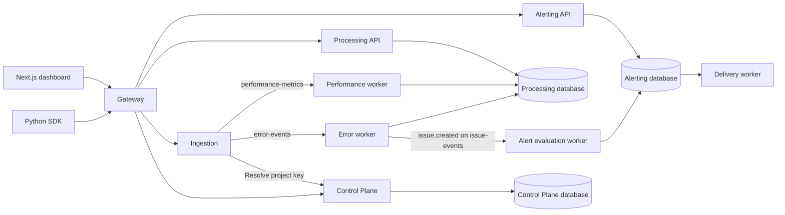

# Architecture

Faultline uses a Python SDK, a Next.js dashboard, FastAPI services, Kafka, Redis, and PostgreSQL. Compose runs a shared PostgreSQL server with separate databases for the Control Plane, Processing, and Alerting. Each service owns its data and migrations.

The labeled telemetry and issue streams run through Kafka. The gateway forwards HTTP requests. Ingestion validates SDK project keys through the Control Plane's internal API and uses Redis to cache resolutions. Processing owns grouped issues, occurrences, and metric buckets. Alerting owns rule evaluation, notification channels, and delivery state.

## Tenant boundaries

Dashboard APIs verify access tokens locally using the shared auth package and verification keys issued by the Control Plane. The verified token's `workspace_id` determines the active tenant. Services scope project and resource queries to that workspace and return `404` for resources outside it. Workspace switching checks membership before issuing a token for the selected workspace. SDK telemetry derives its project and workspace from the resolved project key.

See [user authentication](architecture/user-auth.md), [ingestion authentication](architecture/ingestion-auth.md), and [histogram versioning](architecture/histogram-versioning.md).

## Kafka and failure behavior

- Consumers use at-least-once delivery. They commit offsets after successful processing and let transient failures propagate for redelivery. Permanent message failures are logged and skipped.
- The error worker groups events by project and fingerprint. It inserts occurrences using the event ID for deduplication and increments the issue count only for a new occurrence.
- The error worker publishes `issue.created` after the database transaction commits. If publication fails after retries, the issue remains stored and alerting may miss the event. The two writes have separate failure boundaries.
- See the [event contracts](events.md) and [verification checks](verification.md) for the corresponding code and test paths.
