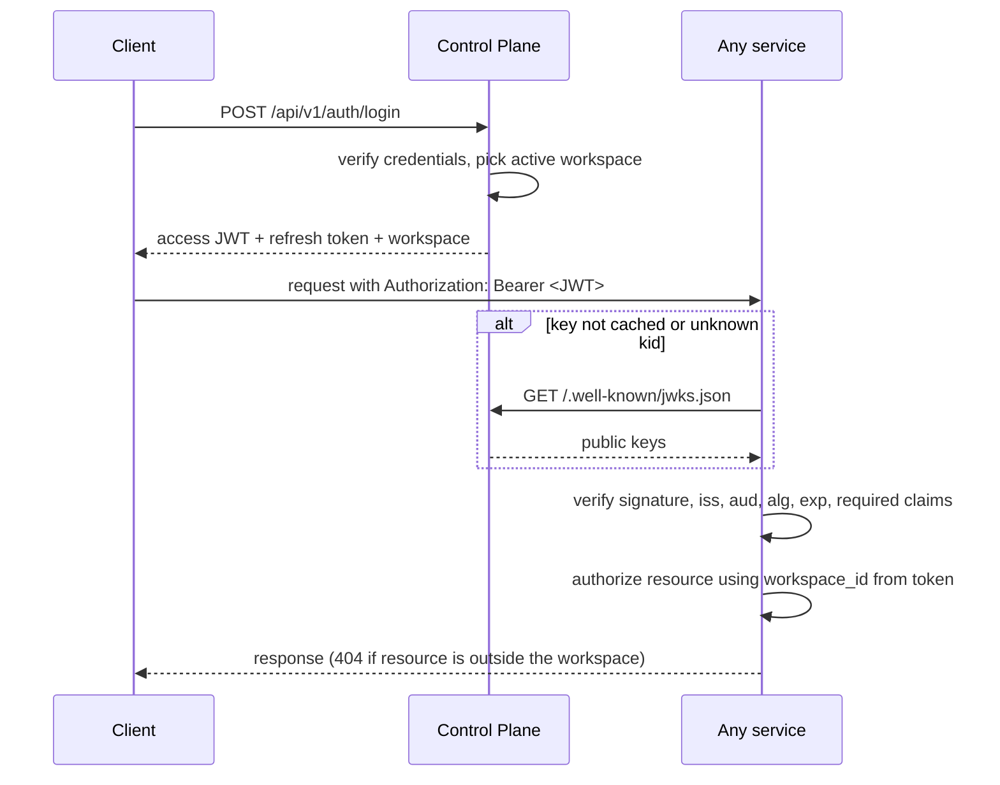
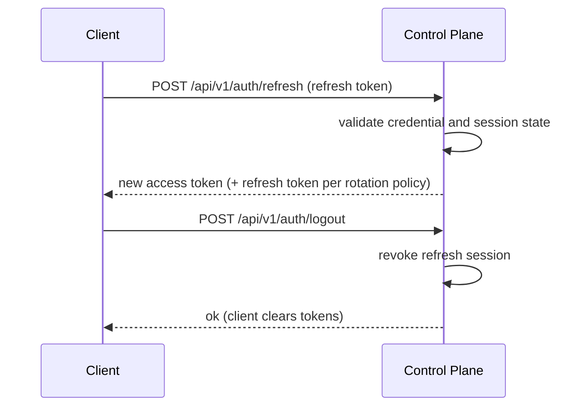

# Authentication and Tenant Isolation

> **Status:** design decided, implementation not verified. Each section marks what is decided and what is still open. Update the status table at the end after auditing the code.

## 1. Summary

- The **Control Plane** is the only component that authenticates users and issues access tokens.
- Access tokens are short-lived **RS256 JWTs**. The Control Plane signs them with a private key.
- Every other service **verifies tokens locally** using public keys from a JWKS endpoint. No service calls the Control Plane per request.
- Verification code lives in the shared package **`libs/faultline-auth`**. Authorization lives in each resource-owning service.
- The active tenant is the **`workspace_id` claim** in the verified token, never a URL, body, query parameter, or client header.
- Refresh sessions are managed centrally so the Control Plane can revoke them.

## 2. Decisions

| Decision | Choice | Why |
|---|---|---|
| Token format | JWT, RS256 | Services verify without holding a signing secret, so a compromised service cannot forge tokens |
| Verification | Local, using cached JWKS | No per-request call to the Control Plane, so no latency cost or single point of failure |
| Key distribution | `GET /.well-known/jwks.json` (public, unauthenticated) | Standard mechanism that supports key rotation via `kid` |
| Shared code | `libs/faultline-auth` | Write verification once, keep it consistent across services |
| Authn vs authz | Authn in `faultline-auth`, authz in the owning service | A valid token proves identity, not access to every resource |
| Tenant selection | `workspace_id` claim in the verified JWT | Prevents clients from choosing another tenant |
| Revocation | Short-lived access tokens, central refresh-session revocation, and a Redis denylist keyed by `sid` (planned) | Covers the window before expiry for logout, bans, and compromise. Trade-offs in section 11 |
| Service-to-service | Separate identity mechanism (not forwarded user tokens) | A user token must not act as a universal service identity |

Alternatives considered: per-request token introspection (rejected: latency, load coupling, single point of failure), shared HMAC secret (rejected: any service could forge tokens), gateway-only validation (rejected as the sole control: unsafe if services are reachable around the gateway).

## 3. Flows

### 3.1 Login and authenticated request



### 3.2 Refresh and logout



## 4. Access token claims

| Claim | Purpose |
|---|---|
| `sub` | User identifier |
| `iss` | Trusted issuer |
| `aud` | Intended audience |
| `iat`, `exp` | Issued-at and expiry |
| `sid` | Refresh/session identifier |
| `jti` | Unique token identifier |
| `workspace_id` | Active tenant for workspace-scoped requests (required) |

Only include claims with a defined purpose. Do not rely on role claims in old tokens if membership or role can change. Services follow the current authorization policy.

Lifetime target: 10 to 15 minutes. Confirm the configured value in code.

## 5. Key management

- Only the token-issuing component holds the **private key**. It never goes in source control, logs, or Postman examples.
- Tokens carry a `kid` header. The JWKS endpoint publishes the current public key(s).
- Services cache keys. On an unknown `kid` they re-fetch the JWKS, then reject the token if the key is still missing.
- Rotation: publish the new key alongside the old one, start signing with the new one, and remove the old key after the longest token lifetime has passed.
- Verifiers fix the accepted algorithm (RS256) in configuration. They never trust the token's `alg` header as the policy.
- `iss` and `aud` values come from configuration shared consistently by issuer and verifiers. Do not hard-code different values per service.

## 6. Refresh sessions

- Refresh sessions are stored by the Control Plane so they can be revoked.
- Opaque random refresh tokens should be stored as a hash, not raw.
- Logout and ban revoke the session.
- Rotation and reuse detection: **Needs decision.** Do not describe either as a feature until implemented and tested.

## 7. The `faultline-auth` library

Location: `libs/faultline-auth/`.

**Provides:** JWKS fetching and caching, token verification, FastAPI auth dependencies, and an authenticated-principal object (`user_id`, `workspace_id`, `sid`).

**Must not contain:** business authorization, workspace repositories, or service-owned database models.

Usage in a service (target API, confirm against the implementation):

```python
from fastapi import Depends
from faultline_auth import get_principal, Principal

@router.get("/issues")
async def list_issues(principal: Principal = Depends(get_principal)):
    return await issue_service.list(workspace_id=principal.workspace_id)
```

Configuration comes from environment variables (`pydantic-settings`): JWKS URL, issuer, audience, accepted algorithm. Docker builds that install it need a build context that includes `libs/`.

## 8. Tenant isolation and authorization

- The active tenant is the verified token's `workspace_id`. Never take it from request bodies, query parameters, frontend slugs, or arbitrary headers.
- Dashboard URLs do not include a workspace ID or slug as a tenant selector (`GET /api/v1/projects`, not `/workspaces/{id}/projects`). Frontend routes may include a slug for navigation only.
- Scope repository queries by `workspace_id` directly, instead of fetching by resource ID and checking ownership afterward.
- Return **404** when a resource is outside the caller's workspace, so existence is not disclosed.
- Enforce authorization in the resource-owning service, not only in the frontend or gateway.
- Keep membership in `workspace_members`. Do not store a single `user_id` on every resource.

Credential separation:

- Project DSNs allow ingestion only. They never grant dashboard, admin, release, or remediation access.
- API keys are stored as hashes where practical, with raw values shown once at creation.
- JWT private keys, refresh secrets, GitHub tokens, Slack signing secrets, and webhook secrets stay out of source control and logs.

## 9. Gateway and service-to-service

- The API gateway routes by path and has no business logic. It may do an initial token check, but services still verify tokens themselves. Gateway-only validation is safe only if services cannot be reached around it.
- Service-to-service calls use a separate identity mechanism. **Needs decision** (for example client-credentials tokens or platform-provided service identity). Do not forward user tokens as service identity.

## 10. Endpoints

| Endpoint | Behavior |
|---|---|
| `POST /api/v1/auth/signup` | Create user, personal workspace, and owner membership |
| `POST /api/v1/auth/login` | Return access token, refresh token, expiry, active workspace |
| `GET /api/v1/auth/me` | Profile, active workspace, memberships |
| `POST /api/v1/auth/refresh` | Validate session, issue renewed credentials |
| `POST /api/v1/auth/logout` | Revoke the refresh session |
| `GET /api/v1/workspaces` | List the user's workspaces |
| `GET /api/v1/workspaces/current` | Active workspace from the JWT claim |
| `GET /.well-known/jwks.json` | Public signing keys, no authentication |

Exact request and response shapes are in the OpenAPI schema and the Postman collection. The collection is a proposed contract and has not been verified against a running API. Its sample JWKS modulus is a placeholder.

## 11. Known limitations

- Logout does not invalidate an already-issued access token. It stays usable until `exp`.
- Role or membership changes are not reflected in tokens already issued.
- Workspace switching is out of scope for now (future work). The active workspace is set at login. When added, the Control Plane must verify membership before issuing a token for the target workspace.
- The denylist (section 11.1) adds one fast Redis lookup per request, so services gain a request-time dependency on Redis.

### 11.1 Denylist (planned)

A Redis denylist will be added to give near-instant revocation.

- **Key:** `sid`, so one entry revokes every access token of a session. This matches logout, bans, and password changes. A `jti` entry can revoke a single token if ever needed.
- **TTL:** equal to the access-token lifetime, so entries expire on their own and the list stays small.
- **Written by:** the Control Plane when a session is revoked (logout, ban, compromise, password change).
- **Checked by:** `libs/faultline-auth`, after signature verification, so services need no custom code. Controlled by a setting.
- **Redis unavailable:** fail open or fail closed is **Needs decision**. Document the choice and test it.
- Until it is implemented and tested, access tokens remain valid until `exp` after logout.

## 12. Open decisions

| Item | Status |
|---|---|
| Access-token lifetime (10 to 15 min target) | Needs decision, confirm in config |
| Refresh-token rotation and reuse detection | Needs decision |
| Refresh-token storage and expiry policy | Needs decision |
| Service-to-service identity mechanism | Needs decision |
| `iss` and `aud` values | Needs decision, must match across services |
| Denylist behavior when Redis is down (fail open or closed) | Needs decision |
| Denylist implementation | Planned |

## 13. Implementation status

Snapshot from the 2026-10-29 handoff, not a code audit.

| Item | Status |
|---|---|
| RS256 signing and token issuance | Planned, check repo |
| JWKS endpoint | Planned, check repo |
| Refresh sessions, logout | Planned, check repo |
| Workspace switching | Future, not in scope |
| `libs/faultline-auth` | Planned. Confirm it exists, is packaged, and is installed in each service that uses it |
| Redis denylist (`sid`) | Planned |
| Postman collection | Generated, not tested against the API |

## 14. Related documents

- ADR: RS256 JWT with JWKS and local verification (to be written)
- ADR: Tenant taken from the JWT `workspace_id` claim (to be written)
- `architecture.md` (when written)