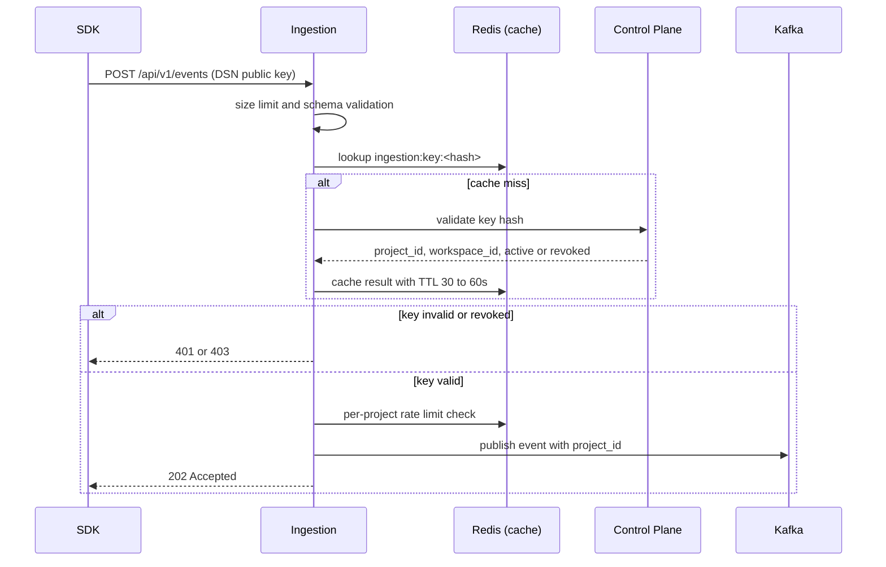

# SDK Authentication (Project API Keys and DSN)

> **Status:** design decided, implementation not verified. Decisions are in sections 2 and 4. Remaining open items are in section 9. For dashboard user authentication (JWTs), see [auth.md](auth.md).

## 1. Summary

- The Python SDK authenticates to the **Ingestion service** with a **project API key** carried in the project **DSN**.
- The key identifies one project and grants **ingestion access only**. It never authorizes dashboard access, project administration, release management, or incident remediation.
- The **Control Plane** creates and owns keys (`project_api_keys`). **Ingestion** verifies them by asking the Control Plane and caching the result in Redis.
- A revoked key can keep working until its cache entry expires (30 to 60 seconds). This is an accepted trade-off.

## 2. Decisions

| Decision | Choice | Why |
|---|---|---|
| Credential | Project API key in the DSN, for example `https://<public-key>@<host>/<project-id>` | Standard SDK pattern. The project ID comes from the DSN |
| Privilege | Ingestion only | A leaked key can only send events to one project |
| Storage | Hash only, raw value shown once at creation | A database leak does not expose usable keys |
| Verification | Ingestion asks the Control Plane to validate the key hash, then caches the result | Keeps one source of truth. Services never read another service's database. No new Kafka topic |
| Cache | Redis, shared by all Ingestion instances, TTL 30 to 60 seconds | One cache for all instances. Expiry bounds the revocation delay |
| Revocation | Delayed by up to the cache TTL. Invalidate-on-revoke is planned as future work | Acceptable because keys are low-privilege (section 5) |
| Rate limiting | Per project, in Redis | Caps the damage from a leaked key |

Alternatives considered:

- **Replicate all keys into Ingestion through Kafka events:** faster at runtime and independent of the Control Plane, but needs initial sync, replay, ordering, and a new topic. Too heavy for the MVP.
- **Signed DSN verified locally:** no lookup, but revocation needs a denylist and rotation is harder.

## 3. Comparison with dashboard auth

| | Dashboard users | SDK / ingestion |
|---|---|---|
| Credential | JWT (RS256) | Project API key (in the DSN) |
| Issued by | Control Plane at login | Control Plane at project creation |
| Verified by | Every service, locally | Ingestion, via Control Plane lookup and Redis cache |
| Grants | Dashboard access to the active workspace | Ingestion only, for one project |
| Revocation | Refresh session plus planned denylist | Key revocation, delayed by the cache TTL |

## 4. Request flow

Ingestion order: payload size limit, schema validation (Pydantic), key validation, rate limiting, Kafka publish, `202 Accepted`.

Rules:

- The project and workspace come from the validated key, never from the request body.
- Events are published only after the key is valid. Return `503` (retryable) if Kafka cannot accept the event. Never return success before the event is accepted.
- Cache negative results ("unknown key") for a very short TTL so bad keys cannot hammer the Control Plane.

## 5. Why the revocation delay is acceptable

- A key can only send events to one project. It cannot read data, change settings, or trigger rollbacks.
- The worst case is up to 60 seconds of fake events from a leaked key. Per-project rate limiting and alert throttling limit the volume.
- The MVP has single-owner workspaces and no customer data at stake.
- The delay is documented here so it is a known trade-off, not a hidden flaw.

This stops being acceptable if keys gain more privileges, or if strict security requirements apply. At that point, add invalidation or shorten the TTL.

## 6. Failure cases

| Case | Expected behavior |
|---|---|
| Unknown or revoked key | Reject before Kafka. Status code (`401` or `403`) is Needs decision |
| Revoked key still cached | Accepted until the TTL expires |
| Control Plane unavailable, key cached | Accept using the cached result until the TTL expires |
| Control Plane unavailable, key not cached | Needs decision. A retryable `503` is safer for SDK behavior than treating it as unauthorized |
| Redis unavailable | Needs decision. Without the cache, every request calls the Control Plane, and rate limiting is affected. Decide whether to degrade or reject |
| Rate limit exceeded | `429`, per project |
| Kafka unavailable | `503`, retryable |

## 7. Redis usage

Redis is infrastructure shared by instances, not shared data between services. Ingestion owns its keys and no other service reads or writes them.

| Key pattern | Purpose | TTL |
|---|---|---|
| `ingestion:key:<key_hash>` | Cached validation result (project, workspace, active or revoked) | 30 to 60s |
| `ingestion:ratelimit:<project_id>` | Per-project rate limit counter | Per window |

The only cross-service Redis key planned is the `sid` denylist described in [auth.md](auth.md). Document any other shared key as an explicit contract.

## 8. Key lifecycle and future work

**Lifecycle (Control Plane):**

- Create: generated at project creation. Store only the hash. Show the raw key once.
- Revoke: mark the key revoked in the Control Plane. Ingestion notices after the cache TTL.
- Rotate: Needs decision (for example, allow two active keys per project during rotation). Exact fields come from `.local/db/schema.dbml`, which is the source of truth.

**SDK behavior:**

- A failed authentication never blocks or crashes the host app. Failed sends are dropped within bounded buffers and limited retries.
- Treat a persistent `401`/`403` as a configuration problem and stop retrying aggressively.

**Future work: invalidate on revoke**

- The Control Plane publishes "key revoked". Each Ingestion instance deletes its cache entry, so revocation takes effect in about a second instead of up to 60.
- Preferred first step: Redis pub/sub, keeping the TTL as the safety net because pub/sub messages are lost if a subscriber is down.
- Kafka is the more reliable transport (replayable), but needs a new topic, an outbox on the Control Plane, and a separate consumer group per Ingestion instance so every instance gets every message. Use it only if guaranteed delivery becomes a requirement.

## 9. Open decisions

| Item | Status |
|---|---|
| Exact TTL (30 to 60s) | Needs decision |
| Behavior when Control Plane is down and key not cached | Needs decision (leaning `503`) |
| Behavior when Redis is down | Needs decision |
| Status codes for invalid and revoked keys | Needs decision |
| Key rotation policy | Needs decision |
| Internal validation endpoint and how Ingestion authenticates to it | Needs decision (see service-to-service identity in auth.md) |
| Invalidate-on-revoke | Planned, later |

## 10. Implementation status

Snapshot from the 2026-10-29 handoff, not a code audit.

| Item | Status |
|---|---|
| `project_api_keys` table and key creation (Control Plane) | Planned, check repo. A test fixture error about this table was reported |
| Key validation endpoint | Planned |
| Ingestion key verification and Redis cache | Planned |
| Per-project rate limiting | Planned |
| SDK DSN parsing | Planned |
| Invalidate-on-revoke | Planned, later |