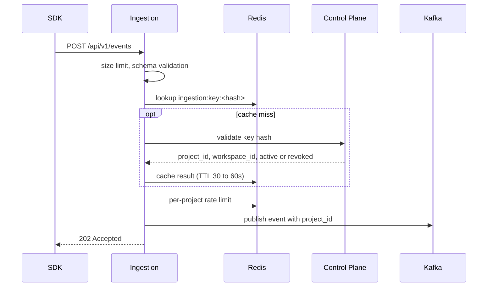

# SDK Authentication

> **Status:** design decided, implementation not verified. See [Status](#status). For dashboard users, see [user-auth.md](user-auth.md).

## Overview

- The Python SDK authenticates to the **Ingestion service** with a **project API key** in the project DSN, for example `https://<project_api_key>@<host>`. The DSN carries only the key and the ingestion host. The project is identified by the validated key, not by an ID in the DSN.
- The key identifies one project and grants **ingestion only**. It never authorizes dashboard access, administration, releases, or remediation.
- The **Control Plane** owns keys. **Ingestion** verifies them by asking the Control Plane and caching the result in Redis.

## Decisions

| Decision | Choice | Reason |
|---|---|---|
| Storage | Hash only, raw key shown once | A database leak exposes no usable keys |
| Verification | Ingestion asks the Control Plane, then caches | One source of truth. No cross-database reads. No new topic |
| Cache | Redis, shared by Ingestion instances, TTL 30 to 60s | One cache for all instances. Expiry bounds the revocation delay |
| Revocation | Delayed by up to the TTL. Invalidate-on-revoke is future work | Acceptable for a low-privilege key (see below) |
| Rate limit | Per project, in Redis | Isolates noisy projects and limits leaked-key damage |

Rejected: replicating all keys to Ingestion through Kafka (sync, replay, and ordering cost too high for the MVP), signed DSNs (revocation and rotation are harder).

## Flow

- Project and workspace come from the validated key, never from the request body.
- Invalid or revoked keys are rejected before Kafka. Unknown keys are cached briefly so bad keys cannot hammer the Control Plane.
- If Kafka cannot accept the event, return a retryable `503`. Never return success before acceptance.

## Revocation delay

A revoked key keeps working until its cache entry expires (30 to 60s). This is acceptable because the key can only send events to one project, per-project rate limits cap the volume, and the MVP has no customer data at stake. Revisit if keys gain more privileges.

**Future work, invalidate on revoke:** the Control Plane publishes "key revoked" and each Ingestion instance deletes its cache entry. Start with Redis pub/sub and keep the TTL as the safety net, since pub/sub messages are lost if a subscriber is down. Use Kafka only if guaranteed delivery is needed (it requires an outbox and a separate consumer group per instance).

## Rate limiting

Each project has its own counter. The MVP uses one default limit for all projects. Per-project limits can later come from `project_settings` and be returned with the key validation result. Numbers are set from load-test results.

## Failure cases

| Case | Behavior |
|---|---|
| Unknown or revoked key | Reject (`401` or `403`, undecided) |
| Revoked key still cached | Accepted until TTL expires |
| Control Plane down, key cached | Use the cached result |
| Control Plane down, key not cached | Undecided, leaning retryable `503` |
| Redis down | Undecided |
| Rate limit exceeded | `429` |
| Kafka down | `503`, retryable |

## Redis keys

Redis is shared infrastructure, not shared data. Ingestion owns these keys and no other service reads or writes them.

| Key | Purpose | TTL |
|---|---|---|
| `ingestion:key:<key_hash>` | Cached validation result | 30 to 60s |
| `ingestion:ratelimit:<project_id>` | Rate limit counter | Per window |

## SDK behavior

Authentication failures never block or crash the host app. Failed sends are dropped within bounded buffers and limited retries. A persistent `401` or `403` is treated as a configuration problem.

## Key lifecycle

Created at project creation (hash stored, raw value shown once). Revoked in the Control Plane. Rotation policy is undecided (for example, two active keys during rotation). Exact fields come from `.local/db/schema.dbml`.

## Open decisions

| Item | Status |
|---|---|
| Exact TTL | Needs decision |
| Behavior when Control Plane or Redis is down | Needs decision |
| Status codes for invalid and revoked keys | Needs decision |
| Key rotation policy | Needs decision |
| Key validation endpoint, and how Ingestion authenticates to it | Needs decision (service-to-service identity) |
| Same rate limit for all projects vs configurable | Needs decision, leaning same default |

## Status

Snapshot from the 2026-10-29 handoff, not a code audit.

| Item | Status |
|---|---|
| `project_api_keys` and key creation (Control Plane) | Planned, check repo. A test fixture error about this table was reported |
| Key validation endpoint | Planned |
| Ingestion verification, Redis cache, rate limiting | Planned |
| SDK DSN parsing | Planned |
| Invalidate-on-revoke | Planned, later |