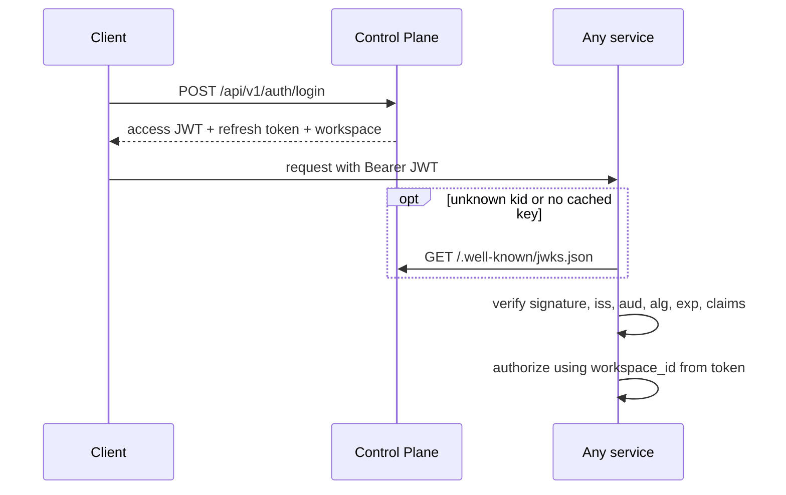

# User Authentication

> **Status:** design decided, implementation not verified. See [Status](#status). For SDK authentication, see [sdk-auth.md](sdk-auth.md).

## Overview

- The **Control Plane** authenticates users and issues access tokens (RS256 JWTs).
- Every other service **verifies tokens locally** using public keys from a JWKS endpoint. No per-request call to the Control Plane.
- Verification lives in the shared package `libs/faultline-auth`. **Authorization** (workspace, role, resource ownership) stays in the service that owns the resource.
- The active tenant is the `workspace_id` claim in the verified token.

## Decisions

| Decision | Choice | Reason |
|---|---|---|
| Token | RS256 JWT, 10 to 15 min lifetime (confirm in config) | Verifiers hold no signing secret, so a compromised service cannot forge tokens |
| Verification | Local, with cached JWKS | No latency cost or single point of failure |
| Tenant | `workspace_id` claim only | Clients cannot choose another tenant |
| Revocation | Refresh-session revocation now, Redis denylist keyed by `sid` planned | Short tokens cover most cases. Denylist covers urgent ones |
| Shared code | `libs/faultline-auth` | One consistent implementation |

Rejected: per-request introspection (latency, load coupling, single point of failure), shared HMAC secret (any service could forge tokens), gateway-only validation (unsafe if services are reachable around it).

## Flow



## Token claims

| Claim | Purpose |
|---|---|
| `sub` | User ID |
| `iss`, `aud` | Issuer and audience, from shared configuration |
| `iat`, `exp` | Issued-at and expiry |
| `sid` | Session ID |
| `jti` | Token ID |
| `workspace_id` | Active tenant (required) |

## Keys

- Only the Control Plane holds the private key. Keep it out of source control, logs, and examples.
- Tokens carry a `kid`. Services cache JWKS and re-fetch on an unknown `kid`.
- Rotation: publish the new key alongside the old one, sign with the new one, remove the old one after the longest token lifetime.
- Verifiers fix the accepted algorithm (RS256) in configuration and never trust the token's `alg` header.

## Refresh sessions

Stored by the Control Plane so they can be revoked. Logout and bans revoke the session. Store opaque refresh tokens as hashes. Rotation and reuse detection are not decided. Do not claim them until implemented and tested.

## Shared library: `libs/faultline-auth`

Provides JWKS caching, token verification, FastAPI dependencies, and a principal object (`user_id`, `workspace_id`, `sid`). It contains no business authorization, repositories, or database models. Configuration comes from environment variables.

```python
@router.get("/issues")
async def list_issues(principal: Principal = Depends(get_principal)):
    return await issue_service.list(workspace_id=principal.workspace_id)
```

## Tenant isolation

- Take the tenant only from the verified token. Never from URLs, bodies, query parameters, or headers.
- API URLs carry no workspace ID or slug (`GET /api/v1/projects`). Frontend slugs are for navigation only.
- Scope queries by `workspace_id` directly. Return `404` for resources outside the workspace.
- Enforce authorization in the owning service, not only in the gateway or frontend.
- The gateway only routes. Services always verify tokens themselves.
- Service-to-service calls use a separate identity, never a forwarded user token.

## Endpoints

| Endpoint | Purpose |
|---|---|
| `POST /api/v1/auth/signup` | Create user, workspace, owner membership |
| `POST /api/v1/auth/login` | Return tokens and active workspace |
| `GET /api/v1/auth/me` | Profile, workspace, memberships |
| `POST /api/v1/auth/refresh` | Renew credentials |
| `POST /api/v1/auth/logout` | Revoke the refresh session |
| `GET /api/v1/workspaces` | List the user's workspaces |
| `GET /api/v1/workspaces/current` | Active workspace |
| `GET /.well-known/jwks.json` | Public keys, no authentication |

Exact schemas are in OpenAPI and the Postman collection (not yet verified against a running API).

## Revocation and limitations

- Logout does not invalidate an issued access token. It stays valid until `exp`.
- Role or membership changes do not affect tokens already issued.
- **Planned denylist:** Redis entry `revoked_sid:<sid>`, TTL equal to the access-token lifetime, written by the Control Plane on logout, ban, or password change, and checked by `faultline-auth` after signature verification. Behavior when Redis is down (fail open or closed) is undecided.
- Workspace switching is out of scope (future work).

## Open decisions

| Item | Status |
|---|---|
| Access-token lifetime | Confirm in config |
| Refresh rotation, reuse detection, storage, expiry | Needs decision |
| Service-to-service identity | Needs decision |
| `iss` and `aud` values | Needs decision, must match across services |
| Denylist behavior when Redis is down | Needs decision |

## Status

Snapshot from the 2026-10-29 handoff, not a code audit.

| Item | Status |
|---|---|
| Token issuance, JWKS, refresh sessions, logout | Planned, check repo |
| `libs/faultline-auth` | Planned. Confirm it exists and is installed in each service |
| Redis denylist | Planned |
| Postman collection | Generated, not tested against the API |